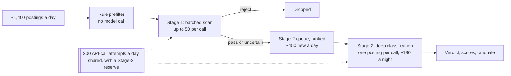

# Job Radar: a two-stage LLM pipeline under a call budget

Private project, deployed and running unattended on a small k3s cluster. The repository stays private because its policy encodes personal career strategy; this page is the engineering. Numbers are dated snapshots, not live metrics.

## Problem

About 1,400 job postings arrive daily across the sources I collect. Deep LLM evaluation of all of them is uneconomical. Keyword filters are cheap but discard exactly the non-standard mandates worth reading. I wanted high recall at near-zero cost and deep classification only where it pays, under a fixed budget.

## Design

Two stages sharing one attempt budget.

**Stage 1** packs up to 50 compact excerpts per call into a lightweight model (`glm-5.3-flash`) and scans for anything worth a deeper look. Benchmarked 2026-09-20 on a small fixture set: 9/9 recall on must-pass targets, including ambiguous titles where the signal sits in the mandate text, and 5/5 rejection of known noise.

**Stage 2** classifies single candidates against a versioned career policy, returning strict JSON: a verdict, dimensional scores, a structured rationale.

The budget is the interesting constraint. The provider plan is a fixed subscription metered in API calls, not tokens: 200 attempts a day shared across both stages, with a small reserve for Stage 2. At the October 2026 cutover about 180 deep classifications completed nightly.

Production still evaluates against the human-prose policy. An executable policy block, hashed to a version string so runs are reproducible, exists as an opt-in experiment. It is not activated: a two-arm benchmark in September was effectively a wash (8/16 versus 9/16), so the gate stays closed until it earns opening.

## Measured failure: the 90-second stopwatch

In late September 2026, Stage 2 began failing about 80% of attempts. On a call-metered plan an aborted request costs the same quota unit as a completed one, so the pipeline was paying full price for nothing.

Benchmarking identical candidates showed every failure cut at 90.1 to 90.2 seconds. The model was not failing; a client stopwatch was terminating valid generations that take 53 to 177 seconds. Raising the timeout to 300 seconds took the same jobs to 5/5. Nightly success went from 18% to 98%, and was 99% on the night of 2026-10-26.

## The withdrawn gain

In a sample of 250 historical verdicts, one geography class received no pursue verdicts. The queue analysis projected about 58% of a night's Stage-2 budget going to it, while classes elsewhere converted at 4.7% to 7.8%. A ranking patch was projected to redirect most of that budget.

Before believing either projection, I replayed the patch exactly against the frozen 2026-10-12 snapshot, using the production ranking function and job-ID tie-breaks. The simulated top 200 still contained 116 postings from the dead class: a Stage-1 priority term preceded both ranking keys, so the swap could not do what the projection said. The projected gain was zero.

I still shipped the swap, because the rule itself was right: within the same Stage-1 priority, a fresh posting in a geography that converts should not queue behind one from a class that never has. But that makes it a correctness fix, not a throughput gain, so I shipped it as an ordering rule and withdrew the throughput claim in the repository record on 2026-10-14.

That null result redirected the work. The bottleneck was never ranking; it was which jobs reach deep classification at all.

## Limitations, and what comes next

- Near-duplicate clusters keyed on normalised company and title pairs suggested only 3% collapsible redundancy. That is a candidate-pair screen, not a dedup recall measurement: distinct locations can share those fields, and cross-company agency duplicates are missed.
- Guardrails against model optimism are caps, not disqualifiers: a long-open posting at a small company, or an early-stage role without equity, can still earn `pursue`, never `strong_pursue`.
- The structural limit: at the 2026-10-12 cutover, roughly 450 new Stage-2 candidates arrived daily against about 180 verdicts. V1 treats a stream of decaying opportunities as a work queue, and inflow beats throughput 2.5:1 where it matters. The next design, currently a proposal, separates an indexed corpus from a bounded active window, extracts stable dimensions once at ingestion instead of re-parsing them per evaluation, and checks whether a posting is still live at the moment it is surfaced.

If you want one question to ask me about this: which of these numbers would survive a change of provider, and how would you find out before the budget pays for it?
